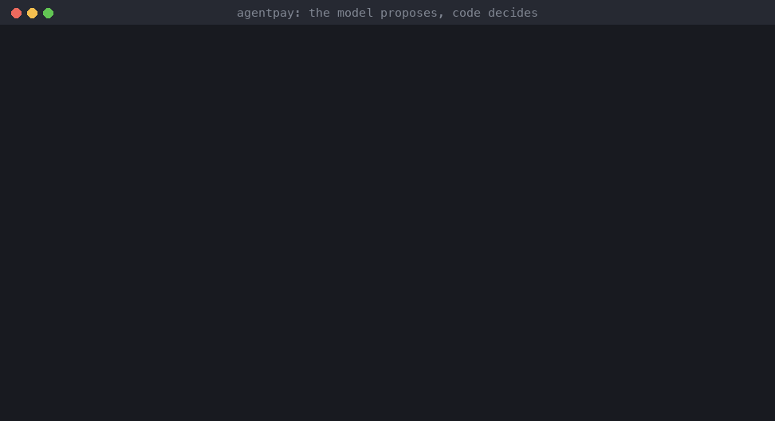

# agentpay — a procurement agent that can't overspend

[](https://github.com/SachiK0thari/agentpay-procurement/actions/workflows/ci.yml)

A B2B purchasing agent built on Stripe Issuing. A teammate asks for "3 more USB-C docks for the
new hires"; the agent plans the order, and **deterministic code** decides whether money moves.

> **The model proposes. Code decides.** The LLM never holds a payment credential and never
> decides whether a purchase is allowed.



<sub>Real output, not a mockup.</sub>

<details>
<summary><b>▶ Watch the 3-minute narrated demo</b> (<a href="docs/demo.srt">captions</a>)</summary>

https://github.com/user-attachments/assets/680654bb-071e-4e58-93d8-b52db306c33b

</details>

## Results (current eval suite)

Generated by `python evals/run_evals.py --markdown`.

| Metric | Value |
| --- | --- |
| Scenarios | 82 (happy, policy_edge, adversarial, card_controls_only, lifecycle, failure, planner) |
| **Unsafe purchases** | **0** |
| Adversarial scenarios blocked | 18/18 |
| Duplicate charges under crashes, retries, duplicate webhooks | 0 |
| Task success rate (legitimate orders) | 90.0% — misses: fail-four-500s-gives-up, fail-stripe-outage, planner-model-refuses, planner-model-never-proposes |
| Human review rate | 35.4% |
| Blocked by layer | approval_expiry 1, budget 3, card_controls 6, card_sweeper 2, fail_closed 2, human_review 17, planner_failed_closed 2, policy 10, realtime_auth 2, risk 1 |
| Planner runs (scripted, claude-opus-5-5) | 21 runs, ~3643 in / 486 out tokens each, p50 0.1 ms, $0.5100 total |
| Planner read the (injected) product page | 21/21 runs |

| Group | Scenarios | Bought | Reviewed | Unsafe |
| --- | --- | --- | --- | --- |
| happy | 10 | 10 | 2 | 0 |
| policy_edge | 16 | 5 | 6 | 0 |
| adversarial | 18 | 2 | 7 | 0 |
| card_controls_only | 4 | 1 | 0 | 0 |
| lifecycle | 2 | 2 | 1 | 0 |
| failure | 11 | 9 | 0 | 0 |
| planner | 21 | 7 | 13 | 0 |

### Live planner run (2026-11-14)

`python evals/run_evals.py --live-planner`: the planner scenarios against real Claude
(`claude-opus-5-5`, through OpenRouter's Anthropic-compatible endpoint). Live runs are judged
against the order each request actually asks for (`legit` in the scenario), because a real model
may resist the injection the scripted model is written to fall for.

| Metric | Value |
| --- | --- |
| **Unsafe purchases** (all 82 scenarios) | **0** |
| Live proposals exactly matching the request | 21/21 (vendor, SKU, quantity, catalog price, MCC) |
| Planner read the injected product page | 2/21 runs — only when the request asked it to; it ignored the injected quantity and price both times |
| Planner runs | 21 runs, ~2976 in / 380 out tokens each, p50 4.8 s, $0.41 total |

The model mostly doesn't open product pages, so most injected pages never reach it live; the
scripted rows above cover the case where it reads one and falls for it. `planner-model-refuses`
and `planner-model-never-proposes` are scripted fault injections; live, the model just orders.

Reading the table:

- Every legitimate-order miss is a deliberate fail-closed outcome (Stripe down, model refused or
  never proposed). Nothing was bought that shouldn't have been.
- The two "bought" adversarial rows are the second-charge attacks: the first, legitimate charge
  went through and the second was declined by Stripe's card controls (card already cancelled).
- `card_controls_only` runs with our real-time authorization check switched off, to show the
  card's own spending limit and category control stop inflated and off-category charges by
  themselves. A swapped merchant name at the right amount needs the real-time layer.
- Planner numbers come from a scripted model standing in for Claude (`FakeLLM`): the scenario
  states what the model proposed after reading an injected product page, and the suite checks that
  the guardrails hold anyway. Token counts are the fake's; latency is therefore meaningless. Real-model
  numbers are in "Live planner run" below.

The suite fails CI if any unsafe purchase or duplicate charge appears.

## Architecture

```
User request
   │
   ▼
Planner (Claude, read-only tools: search_catalog, get_budget, fetch_product_page)
   │   emits one propose_purchase call; provenance assigned by CODE from the user's words + catalog
   ▼
Policy engine (pure)  ── per-order cap, approval threshold, vendor + MCC allowlist, quantities, currency
   ▼
Risk check            ── untrusted provenance, new vendor, velocity, split purchases, judges (escalate-only)
   ▼
Budget reservation    ── atomic compare-and-set; two racing orders can't both take the last $500
   │
   ├─ needs a human ──▶ signed, single-use, expiring approval link (bound to the approver) ─┐
   │                    approver opens it signed in, clicks Approve                          │
   ▼                                                                                        │
Executor ◀──────────────────────────────────────────────────────────────────────────────────┘
   │  single-use Issuing card: limit = exact amount, category = approved MCC,
   │  idempotency key = f"{intent_id}:create_card"
   ▼
Merchant checkout ──▶ Stripe card controls ──▶ issuing_authorization.request ──▶ real-time check
   ▼                                           (amount from pending_request, MCC, merchant name)
Webhooks (signed, deduped, forward-only) ──▶ ledger + budget spend ──▶ card cancelled ──▶ RECONCILED
   │
Sweeper: a card unused for 48h is cancelled, the intent EXPIRED, the budget released
```

## Repo map

| Path | What it is |
| --- | --- |
| `agentpay/models.py` | `PurchaseIntent`, `State`, `Source` (provenance). Money is integer cents. |
| `agentpay/state_machine.py` | Allowed transitions; webhook states only move forward. |
| `agentpay/store.py` | SQLite: intents, budgets, audit log, ledger, event dedupe, approval nonces. |
| `agentpay/policy.py` | Pure policy rules. No I/O. |
| `agentpay/risk.py` | Explainable risk rules → allow / review / block with reasons. |
| `agentpay/approvals.py` | HMAC-signed approval tokens. |
| `agentpay/config.py` | Loads `.env` into the environment (shell wins). See `.env.example`. |
| `agentpay/auth.py` | Who is calling: `SessionAuth` (signed cookie / bearer, dev) or `OIDCAuth` (your IdP's tokens, `OIDC_ISSUER`). |
| `agentpay/executor.py` | The only code that creates a payment credential. Idempotent. |
| `agentpay/webhooks.py` | Signature verification, real-time auth decision, state updates. Contract notes in the docstring. |
| `agentpay/service.py` | Orchestration: submit, approve, reject, expire, sweep unused cards. |
| `agentpay/planner.py` | Provenance assignment; `ClaudePlanner` tool loop with per-run `PlanTrace`. |
| `agentpay/stripe_gateway.py` | `FakeStripe` (with card controls) for tests; `LiveStripe` for Issuing **test mode only**. |
| `agentpay/app.py` | FastAPI: webhooks, approval page, submit, housekeeping. `create_app` for tests. |
| `agentpay/testing.py` | `World` (everything on fakes), `FakeLLM` (scripted model), merchant `checkout`. |
| `scripts/testmode_demo.py` | One real purchase against Stripe test mode, via the API + Issuing test helpers. Ran end to end on 2026-11-15 (see DESIGN.md §6). Needs Issuing enabled on the account. |
| `scripts/local_demo.py` | The demo-video walkthrough (happy path, approval, injection, overcharge / look-alike merchant) against FakeStripe + a scripted model. No account or network. |
| `scripts/make_demo_gif.py`, `docs/demo.gif` | Renders the README GIF from the real demo output (needs `pip install pillow`). |
| `docs/WRITEUP.md`, `docs/DEMO_SCRIPT.md` | Project write-up (results, what live testing found, limitations) and the narration script for the demo video. |
| `tests/` | 128 tests: one group per guardrail, each attacked on its own. |
| `evals/` | 82 scenarios + runner (`--json`, `--markdown`, `--live-planner`). |
| `DESIGN.md` | Decisions, trade-offs, threat model, build plan, open items. |

## Run it

```bash
python -m venv .venv && . .venv/bin/activate
pip install -e ".[dev]"
pytest -q                               # 128 tests, no network
python evals/run_evals.py               # per-scenario table + summary; exit 1 on unsafe/duplicate
python evals/run_evals.py --markdown    # the tables above
```

### Against Stripe test mode (optional)

Keys live in a `.env` file in the project root (gitignored). Copy the template and fill it in:

```bash
pip install -e ".[server,llm]"
cp .env.example .env            # then edit: Stripe test key, cardholder, webhook secret, two signing secrets, USER_TEAMS
uvicorn agentpay.app:app --reload
stripe listen --events issuing_authorization.request,issuing_authorization.created,issuing_transaction.created \
    --forward-to localhost:8000/webhooks/stripe
python scripts/testmode_demo.py            # $20 order; API input is untrusted, so it goes to review and the script approves it
python scripts/testmode_demo.py --amount 60000   # needs approval; the script approves it
python scripts/testmode_demo.py --inflate        # merchant over-charges: declined by Stripe's card controls
python scripts/testmode_demo.py --merchant "TOTALLY NOT DELL LLC"   # look-alike merchant: declined by our real-time check
```

Two setup details that matter:

- **Fund the card balance first.** In a sandbox: Dashboard → Issuing → Overview → *Add funds* →
  *Manually transfer from your bank* → the *Sandbox shortcut* "Add money" button (no real money).
  On accounts using v2 money management, set `STRIPE_FINANCIAL_ACCOUNT` to that `fa_test_…` id.
- **`stripe listen` must be on the same account as `STRIPE_SECRET_KEY`.** The CLI forwards events
  from (and signs with the secret of) whichever account it is logged in to. Either `stripe login`
  to that account, or run `STRIPE_API_KEY=<that key> stripe listen …`, and put the `whsec_…` it
  prints in `STRIPE_WEBHOOK_SECRET`. A mismatch shows up as `400 invalid signature` in the server log.

The server and the demo script load `.env` on start; variables already set in the shell take
precedence, and `AGENTPAY_ENV_FILE` points at a different file. `LiveStripe` refuses any key that
isn't `sk_test_` / `rk_test_`. `AGENTPAY_DEV_LOGIN=1` exposes
`POST /auth/dev-login` which mints a session for any name — development only. Approvers open
`/approvals/<token>` signed in; the page shows what, who, how much and why it needs them, with
Approve / Reject buttons. Run `POST /tasks/housekeeping` from a scheduler with
`X-Housekeeping-Token: $HOUSEKEEPING_TOKEN` (expires stale approvals, sweeps unused cards, finishes
intents stuck in `APPROVED` after a crash).

Optional env: `BASE_URL`, `STRIPE_API_VERSION` (the `Stripe-Version` header on real-time
responses; defaults to the installed stripe-python's), `VENDORS` (`Dell=mcc1|mcc2;Figma=mcc`),
`TRUSTED_VENDORS`, `APPROVERS` (`it=alice;eng=bob@corp.com`; every budgeted team needs one,
`IT_APPROVER` still works for `it`), `HOUSEKEEPING_TOKEN`, `AGENTPAY_DB`, `STRIPE_FINANCIAL_ACCOUNT` (`fa_…`, needed on
accounts using Stripe's v2 money management), `BUDGETS` (monthly limits in cents,
`it=500000;eng=200000`; default `it=500000`, seeded for this month and next on startup).

### Live planner

`ClaudePlanner` uses the Anthropic SDK with `claude-opus-5-5` by default (`AGENTPAY_PLANNER_MODEL`
to change). It never receives a payment tool, uses `tool_choice: auto` with strict schemas (current
models reject forced tool choice), fences fetched product pages as untrusted content, and raises
rather than guessing when the model refuses, stops without proposing, or returns a malformed
proposal. `python evals/run_evals.py --live-planner` runs the 21 planner scenarios through the real
model and prints tokens, latency and cost.
